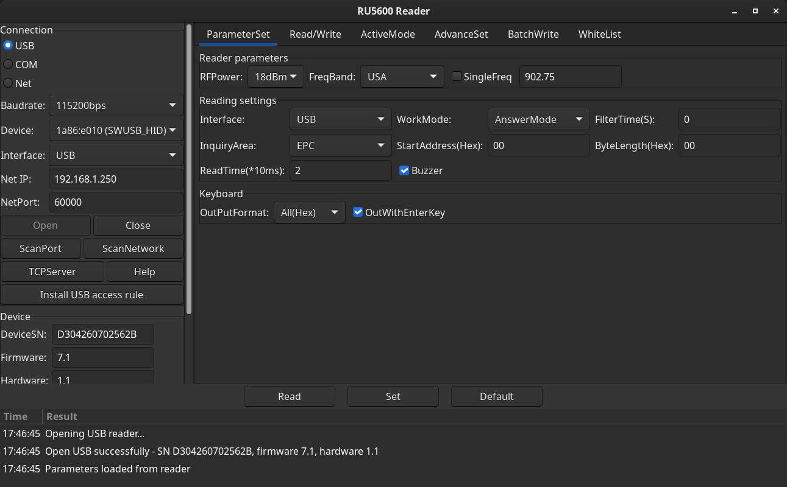

# RU5600 Reader — Linux client for the INVETON RU5600 UHF RFID reader

[](https://madewithrea.com/builds/ru5600-uhf-rfid-reader-linux-client-from-a-protocol-reverse-engineered)

Unofficial Linux replacement for the Windows `ReaderSoftV5.1` that ships with
the RU5600 SDK. It talks to the reader over USB and reproduces the layout of
the original program: connection panel on the left, tabbed parameter pages on
the right, timestamped log at the bottom.



## What it is

* **Transport**: USB, via the vendor's own Linux library `libCFHidApi.so`
  (from `SDK_V3.2/X64/USB/Linux/HidDemo`), which is the same code as the
  Windows `SWHidApi.dll` but built on libusb-1.0.
* **GUI**: Python 3 + GTK 3 (PyGObject).
* **Packaging**: AppImage (x86_64).

The wire protocol was reverse engineered from `SWHidApi.dll` with REA/Ghidra
and is documented in [PROTOCOL.md](PROTOCOL.md).

## Requirements

* Linux x86_64
* Python 3 with PyGObject (`python3-gi`, `gir1.2-gtk-3.0`)
* `libusb-1.0-0` (a private copy is bundled as a fallback)

The reader must be reachable through USB. On Linux the kernel exposes it as a
plain USB device (`1a86:e010`, QinHeng SWUSB_HID), so a udev rule is needed to
use it without root:

```
SUBSYSTEM=="usb", ATTR{idVendor}=="1a86", ATTR{idProduct}=="e010", MODE="0660", GROUP="plugdev"
```

Install it with:

```bash
sudo install -m 644 packaging/99-inveton-ru5600.rules /etc/udev/rules.d/
sudo udevadm control --reload-rules && sudo udevadm trigger
```

The app also has an **"Install USB access rule"** button that does this via
`pkexec` (it will ask for the administrator password).

## Build the AppImage

```bash
cd packaging
APPIMAGETOOL=/path/to/appimagetool ./build_appimage.sh ../dist
```

Produces `dist/ru5600-reader-1.0.0-x86_64.AppImage`.

## Run from source

```bash
python3 src/ru5600_gui.py
```

## Network antennas (TCP)

The vendor ships a Linux library only for the USB desktop reader.  The
**networked antennas speak the same module protocol over TCP**, which was
confirmed by decompiling `SWNetApi.dll` from the Windows SDK: the frames,
the command codes and the response layout are identical, only the
transport differs.

The app therefore has a second transport: pick **Net** in the connection
panel, fill in the antenna address (192.168.1.250 by default) and the
port (60000), and press *Open*.  Everything else - the read modes, the
antenna measurement, the chip analysis, the read and write - works the
same over the network.

> The TCP transport is validated against `tools/mock_antenna.py`, which
> speaks the protocol of the real reader.  It has **not** been run yet
> against a real networked antenna - that is the one thing left to try.

## Command line client

Handy for scripted tests and for checking tags without the GUI:

```bash
python3 src/ru5600_cli.py info
python3 src/ru5600_cli.py inventory
python3 src/ru5600_cli.py watch --seconds 30
python3 src/ru5600_cli.py read --mem EPC --ptr 0 --count 2
python3 src/ru5600_cli.py write --epc 3034333234353536373839303132
python3 src/ru5600_cli.py params
python3 src/ru5600_cli.py freq --band USA
```

## GUI map

| Tab | What it does |
|---|---|
| **ParameterSet** | RF power, frequency band, single frequency, work mode (answer/active), filter time, buzzer, inquiry area, start address / byte length, read time, keyboard output format. |
| **Read/Write** | Read a Gen2 memory bank (EPC/TID/USER) and write the EPC. |
| **ActiveMode** | Continuous read with a live tag table (antenna, EPC, RSSI, hit count, last seen). |
| **AdvanceSet** | Read/set the frequency band, reboot the reader. |
| **Chip info** | Chip identification from the TID (GS1 TDS: manufacturer + model), memory map and access password test. |
| **Risky** | Irreversible operations: Gen2 block lock and raw commands. Both need the *Entiendo el riesgo* box and a confirmation. |
| **BatchWrite / WhiteList** | Not exposed by the vendor Linux API — reachable through the raw command path (0xE8-0xEC). |

The **Read** button performs a one-shot inventory (answer mode).
The **Set** button applies the ParameterSet page to the reader.

## Verified against the physical reader

Everything below was exercised on a real RU5600 on the bench, with two
different UHF tags (96 bit and 192 bit EPC):

| Check | Result |
|---|---|
| `CFHid_OpenDevice` | OK |
| `GetDeviceSystemInfo` | SN `D304260702562B`, firmware `7.1`, hardware `1.1` |
| `ReadDeviceOneParam` | RF power `18` dBm, beep `1`, filter time `0` |
| `ReadFreq` / `SetFreq` | USA `31 80` → Europe `4E 00` → USA `31 80` (read back) |
| `SetDeviceOneParam` | work mode answer ↔ active |
| `StartRead` / `StopRead` | OK |
| Tag detection (active dwell) | 2–5 tag records per scan, every scan |
| `ReadCardG2` EPC bank | `55B334BF` + `E20047019951662B039FD1AD` (CRC + PC + EPC) |
| `ReadCardG2` TID | `E2803813` + `2000662B039FD1AD` |
| `ReadCardG2` USER | zeros (empty bank) |
| `WriteEPCG2` | writes and reads back the same EPC |
| GUI *Open* button | SN, firmware and hardware populate; log entry written |
| GUI *Read* button | finds the tag and fills the table |
| GUI *Read memory* | returns the EPC with its CRC/PC header |
| Chip identification | TID `E2803813` → **Alien Higgs-10 (H10 / 7320 class)**, MDID `0x803`, TMN `0x813` |
| Access password | `00000000` works; every other candidate fails 100 % of the time |
| Memory map | RESERVED 8 bytes, EPC 16 bytes (CRC+PC+96 bit EPC), TID 28 bytes, USER 4 bytes |

### Read modes and the antenna heat map

The **Read mode** selector (connection panel) picks how hard the reader
tries on a single detection. Measured on the bench:

| Mode | Time per detection | Hit rate |
|---|---|---|
| `burst` - one inventory round | 60 ms | 1/8 - the reader refuses the round most of the time |
| `balanced` - six rounds | 0,2-0,4 s | 5/8 |
| `reliable` - keeps going | 0,3-2,4 s | **8/8** |

```bash
ru5600_cli.py inventory --mode burst     # fastest
ru5600_cli.py inventory --mode reliable   # 8/8
```

For measuring the **reading speed and the antenna signal** - the numbers
to compare when mapping the reading area of an antenna - use the *heat*
measurement. The reader is switched to active mode and left streaming
while the tag buffer is polled:

```bash
ru5600_cli.py heat --seconds 10
```

```
elapsed        : 10.0 s
detections     : 51 (5.10/s)
RSSI           : avg 71.5 min 45 max 90 (51 samples)
  E20047019951662B039FD1AD: 51 detections
```

In the GUI the same numbers are in the *ActiveMode* tab: the *Measure*
button runs the measurement and the status line shows the detection rate
and the RSSI average, minimum and maximum.

### Chip info tab

Identifies the chip from its TID (GS1 TDS: MDID = manufacturer, TMN =
model), maps which memory banks are readable, and verifies access
password candidates.

```bash
ru5600_cli.py chip              # identification only (~1-2 s)
ru5600_cli.py chip --deep       # + memory map (~5-6 s)
ru5600_cli.py password --password 00000000
```

**Important**: the reader refuses most commands if they arrive too fast,
and a memory read only succeeds inside a short window (roughly 4 accepted
commands every 3.3 s). The client paces every command and retries - see
[PROTOCOL.md](PROTOCOL.md) for the measurements.

## Notes

* Only one program can use the reader at a time - the USB interface is
  claimed exclusively. If *Open* fails while the reader is plugged in,
  close the other client (the CLI, or a second copy of this app).
* Memory reads need the Gen2 **access password** of the tag
  (`00000000` for an unprotected tag). The field is on the *Read/Write*
  tab; a wrong password fails on every attempt.
* `libCFHidApi.so` is the vendor's file, redistributed as-is from the SDK for
  interoperability with the hardware.
